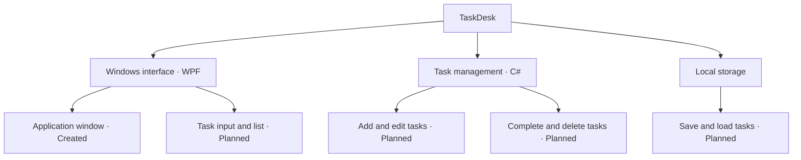

# TaskDesk

A Windows desktop task manager built with C# and WPF.

## Project status

The initial WPF project has been created.
Task management features are not implemented yet.

## Project map



## Roadmap

- [x] Create the WPF project
- [x] Set up Git and GitHub
- [ ] Build the task interface
- [ ] Add tasks
- [ ] Complete and delete tasks
- [ ] Edit tasks
- [ ] Save and load tasks
- [ ] Publish a Windows executable

## Run locally

Requires Windows and the .NET 10 SDK.

```powershell
dotnet run --project src/TaskDesk
```
